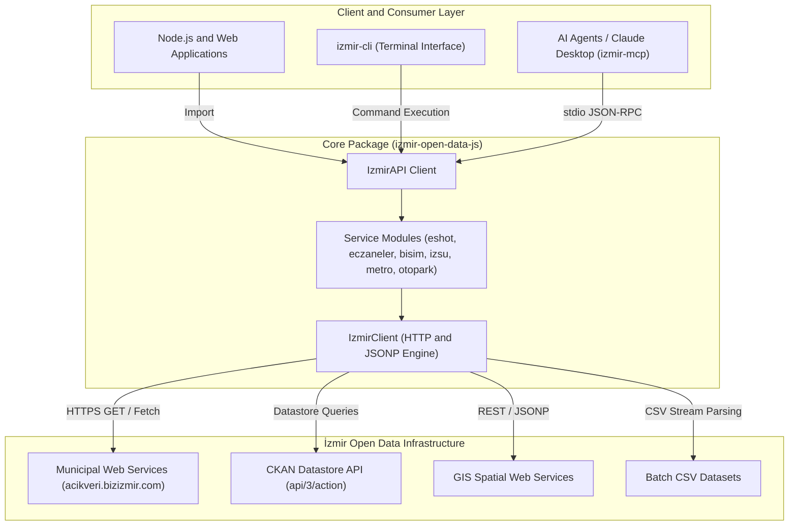

<p align="center">
  
</p>

# izmir-open-data-js

TypeScript and JavaScript client SDK, terminal CLI utility, and Model Context Protocol (MCP) server for the İzmir Metropolitan Municipality Open Data Portal API services.

[](https://github.com/AtaCanYmc/izmir-open-data-js/actions/workflows/ci.yml)
[](https://www.npmjs.com/package/izmir-open-data-js)
[](https://opensource.org/licenses/Apache-2.0)
[](https://nodejs.org)
[](https://www.typescriptlang.org/)

[English](README.en.md) | [Türkçe](README.md)

---

## Table of Contents

- [System Architecture](#system-architecture)
- [Installation](#installation)
- [Quick Start](#quick-start)
  - [1. Programmatic Library Usage](#1-programmatic-library-usage)
  - [2. Terminal CLI Utility](#2-terminal-cli-utility)
  - [3. Model Context Protocol (MCP) Server](#3-model-context-protocol-mcp-server)
- [Endpoint Modules](#endpoint-modules)
- [Code Examples](#code-examples)
- [Repository Structure](#repository-structure)
- [Development and Testing](#development-and-testing)
- [Technical FAQ](#technical-faq)
- [Contributing](#contributing)
- [License](#license)

---

## System Architecture

The package provides a unified client layer across application runtimes, terminal users, and autonomous LLM agents. The underlying client engine relies on native `fetch` in Node.js environments and switches automatically to JSONP in browser contexts to bypass CKAN cross-origin constraints.



---

## Installation

Install as a project dependency:

```bash
npm install izmir-open-data-js
```

Or using yarn or pnpm:

```bash
yarn add izmir-open-data-js
# or
pnpm add izmir-open-data-js
```

---

## Quick Start

### 1. Programmatic Library Usage

The library exports complete TypeScript interfaces. Instantiate `IzmirAPI` to access namespaced municipal endpoints:

```typescript
import { IzmirAPI } from "izmir-open-data-js";

const api = new IzmirAPI();

// Query active duty pharmacies
const pharmacies = await api.eczaneler.getNobetciList();
console.log(`Active duty pharmacies: ${pharmacies.length}`);

// Retrieve public bus routes
const busLines = await api.eshot.getHatlar();
console.log(`Total bus lines: ${busLines.length}`);

// Query smart bike station availability
const bisim = await api.bisim.getIstasyonList();
console.log("BİSİM status:", bisim);
```

### 2. Terminal CLI Utility

Use the bundled `izmir-cli` executable to inspect datasets directly from your terminal rendered as ASCII tables:

```bash
# Display duty pharmacies in a formatted terminal table
npx izmir-cli get nobetcieczaneler

# Query smart bike station statuses
npx izmir-cli get cbs/bisimistasyon

# Query hospital locations and contact details
npx izmir-cli get cbs/hastaneler
```

For complete command syntax and column handling rules, see [docs/CLI.md](docs/CLI.md).

### 3. Model Context Protocol (MCP) Server

`izmir-open-data-js` includes a standard Model Context Protocol server (`izmir-mcp`) allowing AI assistants (Claude Desktop, Cursor, Antigravity) to query municipal datasets natively.

Add to `claude_desktop_config.json`:

```json
{
  "mcpServers": {
    "izmir-open-data": {
      "command": "npx",
      "args": ["-y", "izmir-open-data-js"]
    }
  }
}
```

For tool schemas and stdio configurations, see [docs/MCP.md](docs/MCP.md).

---

## Endpoint Modules

The library organizes municipal services into distinct domain namespaces:

| Domain | Namespace | Scope and Primary Methods |
| --- | --- | --- |
| **Public Transit** | `api.eshot`, `api.metro`, `api.tramvay`, `api.izban`, `api.vapur` | Bus lines, stops, timetables, routes, and active vehicle GPS coordinates. |
| **Micro-mobility** | `api.bisim`, `api.taksi` | BİSİM bike stations, real-time bicycle counts, and taxi stands. |
| **Healthcare** | `api.eczaneler`, `api.saglik` | On-duty pharmacies, all registered pharmacies, hospitals, and emergency stations. |
| **Utilities and Civil** | `api.izsu`, `api.otopark`, `api.afetler` | Dam water levels, water production, parking occupancy, and disaster assembly zones. |
| **City & Hygiene** | `api.tuvalet`, `api.turuncucember`, `api.itfaiye`, `api.izum`, `api.trafik` | Smart public restrooms, Orange Circle hygiene-certified businesses, fire incidents, and İZUM traffic speeds. |
| **Culture and Education** | `api.kultur`, `api.etkinlikler`, `api.egitim` | Libraries, museums, theaters, public schools, and municipal event calendars. |
| **Public Administration** | `api.kamu`, `api.cografi`, `api.muhtarliklar` | Notaries, neighborhood administration offices, post offices, lakes, and peaks. |
| **Open Data CKAN** | `api.ckan`, `client.getCKAN()`, `client.getCKANDump()` | Search 260+ datasets (`searchPackages`), filter datastores (`searchDatastore`), and download dumps. |

For the complete parameter list and response types, consult [docs/ENDPOINTS.md](docs/ENDPOINTS.md). For official municipality web service specifications, see [Official Specifications (Specs)](docs/specs/README.md).

---

## Code Examples

The repository includes runnable TypeScript example scripts demonstrating domain queries. Run them directly using `tsx`:

```bash
# ESHOT bus line and stop queries
npx tsx examples/eshot-example.ts

# BİSİM smart bike station queries
npx tsx examples/bisim-example.ts

# İZSU dam water levels and production metrics
npx tsx examples/izsu.ts
```

For the complete list of sample scripts, see [examples/README.md](examples/README.md) and [docs/EXAMPLES.md](docs/EXAMPLES.md).

---

## Repository Structure

```text
izmir-open-data-js/
├── .github/
│   ├── ISSUE_TEMPLATE/        # Structured bug report and feature request forms
│   ├── PULL_REQUEST_TEMPLATE/ # Pull request template enforcing verification
│   └── workflows/             # CI, linting, security, and release pipelines
├── docs/                      # CLI, MCP, and endpoint reference documents
├── examples/                  # Executable example scripts for each domain
├── src/
│   ├── cli/                   # izmir-cli terminal application source
│   ├── common/                # Shared utilities and core type definitions
│   ├── endpoints/             # Modular endpoint classes for each municipal API
│   ├── mcp/                   # Model Context Protocol stdio server implementation
│   ├── client.ts              # HTTP and JSONP transport engine
│   └── index.ts               # Primary library export (IzmirAPI)
├── tests/                     # Unit and integration test suites
├── Makefile                   # Automation targets for build, lint, and test
├── LICENSE                    # Apache 2.0 license text
├── CONTRIBUTING.md            # Contribution guidelines and Conventional Commits
├── SECURITY.md                # Security policy and private disclosure channel
└── ROADMAP.md                 # Semantic version milestones and project roadmap
```

---

## Development and Testing

Execute the verification pipeline with a single `make` command:

```bash
# Run full verification pipeline (build + lint + test)
make check

# View all available automation targets
make help
```

Standard `npm` commands are supported as alternatives:

```bash
# 1. Install dependencies
npm install

# 2. Compile TypeScript source code (emits to dist/)
npm run build

# 3. Run ESLint static analysis
npm run lint

# 4. Automatically fix linter formatting violations
npm run lint:fix

# 5. Execute unit tests (no network requests)
npm test

# 6. Generate test coverage report
npm run test:coverage

# 7. Execute live API integration tests against upstream servers
LIVE_API_TESTS=1 npm run test:live
```

---

## Technical FAQ

### Does this package run directly in browser runtimes?
Yes. The package is distributed as an ECMAScript Module (ESM). In Node.js, requests execute through native `fetch`. In browser environments, CKAN datastore requests automatically fall back to JSONP to circumvent cross-origin CORS limitations on municipal servers.

### Do I need to obtain an API key?
No. The İzmir Metropolitan Municipality Open Data Portal exposes public endpoints without mandatory API key authentication. Upstream servers may impose IP-based rate limiting under excessive traffic.

### Does the MCP server function without internet access?
The `izmir-mcp` binary is a local process communicating with the client over `stdio`. It requires outbound HTTPS internet access to retrieve live municipal records from the open data servers.

---

## Contributing

Bug reports, missing endpoint definitions, and documentation refinements are welcome. Please read [CONTRIBUTING.md](CONTRIBUTING.md) for branch naming conventions, Conventional Commits specifications, and verification requirements.

For security vulnerabilities, follow the private reporting process outlined in [SECURITY.md](SECURITY.md).

---

## License

This project is licensed under the [Apache 2.0 License](LICENSE). Copyright (c) 2026 Ata Can Yaymacı.
