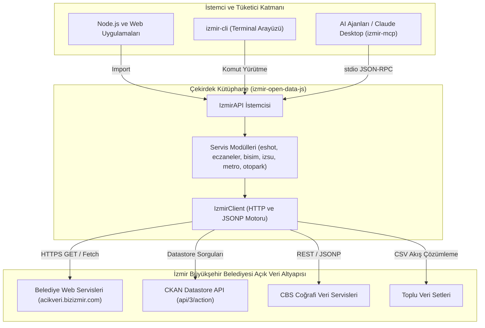

<p align="center">
  
</p>

# izmir-open-data-js

İzmir Büyükşehir Belediyesi Açık Veri Portalı API servisleri için geliştirilmiş TypeScript ve JavaScript istemci kütüphanesi, terminal CLI aracı ve Model Context Protocol (MCP) sunucusu.

[](https://github.com/AtaCanYmc/izmir-open-data-js/actions/workflows/ci.yml)
[](https://www.npmjs.com/package/izmir-open-data-js)
[](https://opensource.org/licenses/Apache-2.0)
[](https://nodejs.org)
[](https://www.typescriptlang.org/)

[Türkçe](README.md) | [English](README.en.md)

---

## İçindekiler

- [Sistem Mimarisi](#sistem-mimarisi)
- [Kurulum](#kurulum)
- [Hızlı Başlangıç](#hızlı-başlangıç)
  - [1. Programatik Kütüphane Kullanımı](#1-programatik-kütüphane-kullanımı)
  - [2. Terminal CLI Aracı](#2-terminal-cli-aracı)
  - [3. Model Context Protocol (MCP) Sunucusu](#3-model-context-protocol-mcp-sunucusu)
  - [4. Gelişmiş Özellikler (Önbellek, Retry, CKAN Sorgu Oluşturucu, GeoJSON)](#4-gelişmiş-özellikler-önbellek-retry-ckan-sorgu-oluşturucu-geojson)
- [Uç Nokta ve Servis Modülleri](#uç-nokta-ve-servis-modülleri)
- [Kod Örnekleri](#kod-örnekleri)
- [Proje Dizin Yapısı](#proje-dizin-yapısı)
- [Geliştirme ve Test](#geliştirme-ve-test)
- [Teknik Sıkça Sorulan Sorular (FAQ)](#teknik-sıkça-sorulan-sorular-faq)
- [Katkıda Bulunma](#katkıda-bulunma)
- [Lisans](#lisans)

---

## Sistem Mimarisi

Kütüphane; uygulama kodları, komut satırı kullanıcıları ve yapay zeka ajanları için ortak bir istemci katmanı sunar. İstemci motoru Node.js üzerinde yerel `fetch` API'sini, tarayıcı ortamlarında ise CKAN kısıtlamalarını aşmak için JSONP mekanizmasını kullanır.



---

## Kurulum

Projeye bağımlılık olarak eklemek için:

```bash
npm install izmir-open-data-js
```

Yarn veya pnpm ile kurulum:

```bash
yarn add izmir-open-data-js
# veya
pnpm add izmir-open-data-js
```

---

## Hızlı Başlangıç

### 1. Programatik Kütüphane Kullanımı

Kütüphane tam TypeScript tip tanımlamaları içerir. `IzmirAPI` sınıfı üzerinden ilgili servis ad alanlarına erişebilirsiniz:

```typescript
import { IzmirAPI } from "izmir-open-data-js";

const api = new IzmirAPI();

// Nöbetçi eczaneleri sorgulama
const eczaneler = await api.eczaneler.getNobetciList();
console.log(`Nöbetçi eczane sayısı: ${eczaneler.length}`);

// ESHOT hat listesini sorgulama
const hatlar = await api.eshot.getHatlar();
console.log(`Toplam hat sayısı: ${hatlar.length}`);

// BİSİM istasyon doluluk oranlarını alma
const bisim = await api.bisim.getIstasyonList();
console.log("BİSİM Durumu:", bisim);
```

### 2. Terminal CLI Aracı

`izmir-cli` aracı ile belediye veri setlerini doğrudan terminalde ASCII tablosu formatında görüntüleyebilirsiniz.

Homebrew ile kurulum (macOS / Linux):

```bash
brew tap AtaCanYmc/tap
brew install izmir-cli
# veya tek komutla doğrudan:
brew install AtaCanYmc/tap/izmir-cli
```

Veya `npx` ile anında çalıştırma:

```bash
# Nöbetçi eczaneleri terminal tablosunda listeleme
izmir get nobetcieczaneler
# veya
npx izmir-cli get nobetcieczaneler

# BİSİM istasyonlarını sorgulama
izmir get cbs/bisimistasyon

# Hastane konumlarını sorgulama
izmir get cbs/hastaneler
```

Ayrıntılı komut seçenekleri ve parametreler için [CLI Dokümantasyonu](docs/CLI.md) sayfasına başvurabilirsiniz.

### 3. Model Context Protocol (MCP) Sunucusu

`izmir-open-data-js`, Claude Desktop veya Cursor gibi yapay zeka araçlarına belediye verilerini sunan standart bir MCP sunucusu (`izmir-mcp`) barındırır.

`claude_desktop_config.json` dosyasına ekleyin:

```json
{
  "mcpServers": {
    "izmir-open-data": {
      "command": "npx",
      "args": ["-y", "izmir-open-data-js"]
    }
  }
}
```

Entegrasyon şemaları ve sunucu araçları için [MCP Dokümantasyonu](docs/MCP.md) sayfasına başvurabilirsiniz.

### 4. Gelişmiş Özellikler (Önbellek, Retry, CKAN Sorgu Oluşturucu, GeoJSON)

#### In-Memory TTL Önbellek (Cache)

Belediye sunucularına mükerrer istek gönderilmesini engellemek için TTL tabanlı dahili bellek önbelleği:

```typescript
import { IzmirAPI } from "izmir-open-data-js";

// 5 dakika varsayılan TTL ile önbelleği aktifleştirme
const api = new IzmirAPI({
    cache: true,
});

// Veya özel TTL (milisaniye) ve azami kayıt adedi ile:
const customApi = new IzmirAPI({
    cache: {
        defaultTtlMs: 60_000, // 1 dakika
        maxItems: 200,
    },
});

// İlk çağrı ağdan çeker, ikincisi bellekten anında döner
const eczaneler1 = await api.eczaneler.getNobetciList();
const eczaneler2 = await api.eczaneler.getNobetciList();

// Gerektiğinde önbelleği temizleme
api.clearCache();
```

#### İstek Yeniden Deneme (Retry Middleware)

Geçici 5xx sunucu hataları ve ağ kesintilerinde rastgele sapmalı (jitter) üstel geri çekilme:

```typescript
const api = new IzmirAPI({
    retry: {
        retries: 3,         // Azami 3 deneme
        baseDelayMs: 300,   // Başlangıç beklemesi (ms)
        maxDelayMs: 3000,   // Tavan bekleme (ms)
        jitter: true,       // Yük yığılmasını önleyen rastgele sapma
    },
});
```

#### CKAN Akıcı Sorgu Oluşturucu (Query Builder)

CKAN Datastore üzerinde zincirleme filtreleme, metin araması, sıralama ve otomatik sayfalama:

```typescript
const query = api.ckan.query("d87de3c1-9bc0-4a8c-842a-90cd2a30d03a")
    .where("ILCE", "KONAK")
    .search("Alsancak")
    .sort("TARIH", "desc")
    .page(1, 20);

// İlk sayfayı çekme
const result = await query.execute();
console.log(result.records);

// Otomatik sayfalamayla tüm kayıtları çekme
const allRecords = await query.fetchAll({ batchSize: 100, maxRecords: 500 });
```

#### GeoJSON Geometri Dönüştürücüsü (GeoJSON Normalizer)

Farklı belediye veri formatlarını (CBS `BOYLAM`/`ENLEM`, Yazılım Şube `LokasyonX`/`LokasyonY`) standart RFC 7946 GeoJSON formatına dönüştürme:

```typescript
import { toGeoJSON, extractCoordinates } from "izmir-open-data-js";

// Tekil nokta koordinatını [boylam, enlem] olarak alma
const coords = extractCoordinates({ LokasyonX: "38.4192", LokasyonY: "27.1287" });
// [27.1287, 38.4192]

// CBS veya POI listesini standart GeoJSON FeatureCollection formatına dönüştürme
const parklar = await api.cografi.getMeydanlarList();
const geojson = toGeoJSON(parklar);

console.log(geojson.type); // "FeatureCollection"
console.log(geojson.features[0].geometry.coordinates); // [27.1428, 38.4237]
```

---

## Uç Nokta ve Servis Modülleri

Kütüphane, İzmir Açık Veri Portalı üzerindeki servisleri modüler ad alanlarına ayırır:

| Modül | Ad Alanı | Kapsam ve Temel Metotlar |
| --- | --- | --- |
| **Toplu Ulaşım** | `api.eshot`, `api.metro`, `api.tramvay`, `api.izban`, `api.vapur` | Hatlar, duraklar, hareket saatleri, güzergahlar ve canlı otobüs konumları. |
| **Mikro Hareketlilik** | `api.bisim`, `api.taksi` | BİSİM akıllı bisiklet istasyonları, bisiklet dolulukları ve taksi durakları. |
| **Sağlık & Eczane** | `api.eczaneler`, `api.saglik` | Nöbetçi eczaneler, tüm eczaneler, hastaneler ve acil yardım istasyonları. |
| **Su & Altyapı** | `api.izsu`, `api.otopark`, `api.afetler` | Baraj doluluk oranları, su üretimi, otopark dolulukları ve toplanma alanları. |
| **Kent & Hijyen** | `api.tuvalet`, `api.turuncucember`, `api.itfaiye`, `api.izum`, `api.trafik` | Akıllı tuvaletler, Turuncu Çember sertifikalı işletmeler, itfaiye acil müdahaleleri, İZUM hız verileri. |
| **Kültür & Sosyal** | `api.kultur`, `api.etkinlikler`, `api.egitim` | Kütüphaneler, müzeler, sinemalar, okullar ve belediye etkinlik takvimi. |
| **Kamu & Coğrafya** | `api.kamu`, `api.cografi`, `api.muhtarliklar` | Noterler, muhtarlıklar, PTT, göller, dağlar ve kıyı şeridi bilgileri. |
| **Açık Veri CKAN** | `api.ckan`, `client.getCKAN()`, `client.getCKANDump()` | 260+ veri setinde arama (`packageSearch`), filtreleme, `searchDatastore` ve dump indirme. |

Uç noktaların tam parametre listesi için [Uç Nokta Referansı](docs/ENDPOINTS.md), belediye birimlerinin resmi şartnameleri için [Resmi Şartnameler (Specs)](docs/specs/README.md) sayfasına bakabilirsiniz.

---

## Kod Örnekleri

Depoda her servis için ayrıntılı örnek betikler yer almaktadır. Bu betikleri `tsx` ile doğrudan çalıştırabilirsiniz:

```bash
# ESHOT durak ve hat sorgu örnekleri
npx tsx examples/eshot-example.ts

# BİSİM istasyon sorgu örnekleri
npx tsx examples/bisim-example.ts

# İZSU baraj doluluk ve su üretim örnekleri
npx tsx examples/izsu.ts
```

Tüm örnek dosyalarının açıklaması için [Örnekler Kılavuzu](examples/README.md) ve [docs/EXAMPLES.md](docs/EXAMPLES.md) dokümanlarına bakabilirsiniz.

---

## Proje Dizin Yapısı

```text
izmir-open-data-js/
├── .github/
│   ├── ISSUE_TEMPLATE/        # Yapılandırılmış hata ve öneri formları
│   ├── PULL_REQUEST_TEMPLATE/ # Doğrulama adımlarını zorunlu kılan PR şablonu
│   └── workflows/             # CI, lint, güvenlik ve yayınlama iş akışları
├── docs/                      # CLI, MCP ve uç nokta dokümantasyonları
├── examples/                  # Her servis için çalıştırılabilir örnek betikler
├── Formula/                   # Homebrew Tap formül tanımlamaları
├── src/
│   ├── cli/                   # izmir-cli terminal aracı kaynak kodları
│   ├── common/                # Tipler ve ortak yardımcı fonksiyonlar
│   ├── endpoints/             # Her belediye servisi için modüler API sınıfları
│   ├── mcp/                   # Model Context Protocol stdio sunucu modülü
│   ├── client.ts              # HTTP ve JSONP istek motoru
│   └── index.ts               # Ana kütüphane dışa aktarımı (IzmirAPI)
├── tests/                     # Vitest birim ve entegrasyon test paketleri
├── Makefile                   # Geliştirme ve test otomasyon hedefleri
├── LICENSE                    # Apache 2.0 lisans metni
├── CONTRIBUTING.md            # Katkı ve commit kuralları
├── SECURITY.md                # Güvenlik açığı bildirim politikası
└── ROADMAP.md                 # Sürüm hedefleri ve geliştirme yol haritası
```

---

## Geliştirme ve Test

Tüm derleme, lint ve test süreçlerini `make` üzerinden tek komutla yürütebilirsiniz:

```bash
# Tüm pipeline'ı doğrulama (build + lint + test)
make check

# Kullanılabilir tüm Makefile hedeflerini listeleme
make help
```

Aşağıdaki doğrudan `npm` komutları da alternatif olarak kullanılabilir:

```bash
# 1. Bağımlılıkları kurma
npm install

# 2. TypeScript kodunu derleme (dist/ dizini oluşturur)
npm run build

# 3. Kod standartları ve linter kontrolü
npm run lint

# 4. Linter biçimlendirme hatalarını otomatik düzeltme
npm run lint:fix

# 5. Birim testlerini çalıştırma (ağ erişimi gerektirmez)
npm test

# 6. Test kapsamı (coverage) raporu üretme
npm run test:coverage

# 7. Canlı API entegrasyon testlerini çalıştırma (ağ erişimi gerektirir)
LIVE_API_TESTS=1 npm run test:live
```

---

## Teknik Sıkça Sorulan Sorular (FAQ)

### Bu kütüphane tarayıcı ortamlarında doğrudan çalışır mı?
Evet. Kütüphane evrensel modül yapısına (`ESM`) sahiptir. Node.js ortamında yerel `fetch` motoru kullanılır. Tarayıcı ortamında çalıştırıldığında, CKAN API'sinin CORS kısıtlamalarına takılmaması için otomatik olarak JSONP mekanizmasına geçer.

### API anahtarı (token) almam gerekiyor mu?
Hayır. İzmir Büyükşehir Belediyesi Açık Veri Portalı uç noktaları halka açık olarak sunulmaktadır. Çoğu uç nokta kimlik doğrulama gerektirmez. Ancak aşırı istek durumunda belediye sunucuları IP bazlı hız kısıtlaması (rate limiting) uygulayabilir.

### MCP sunucusu internet erişimi olmadan çalışır mı?
`izmir-mcp` yerel bir `stdio` sürecidir. Ancak asistanın talep ettiği verileri getirmek için belediyenin açık veri sunucularına giden giden HTTPS bağlantısına ihtiyaç duyar.

---

## Katkıda Bulunma

Hata bildirimleri, yeni uç nokta eklemeleri ve dokümantasyon düzeltmeleri memnuniyetle karşılanır. Geliştirme standartları, branch isimlendirme ve Conventional Commits kuralları için lütfen [CONTRIBUTING.md](CONTRIBUTING.md) dosyasını inceleyin.

Güvenlik açıklarını bildirmek için [SECURITY.md](SECURITY.md) dosyasındaki özel iletişim yönergelerini takip edin.

---

## Lisans

Bu proje [Apache 2.0 Lisansı](LICENSE) kapsamında lisanslanmıştır. Telif hakkı (c) 2026 Ata Can Yaymacı.
